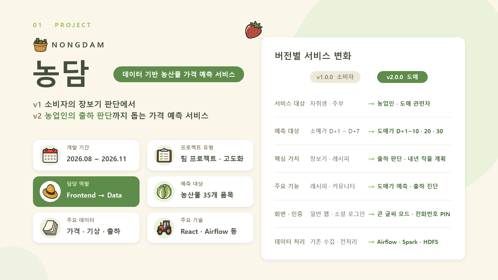
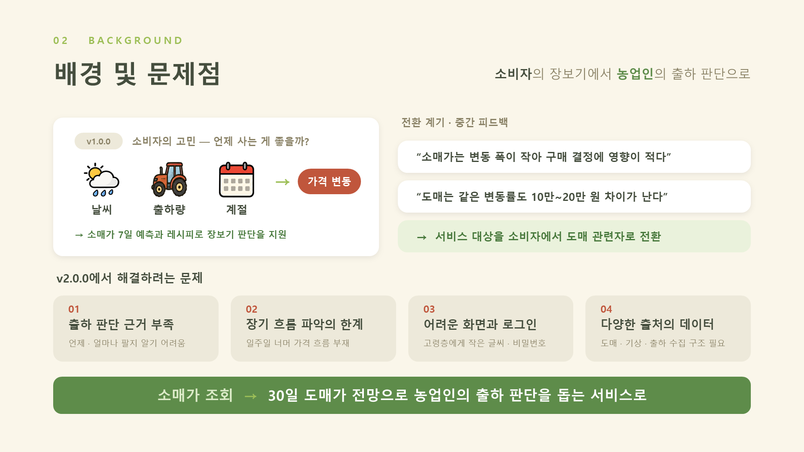
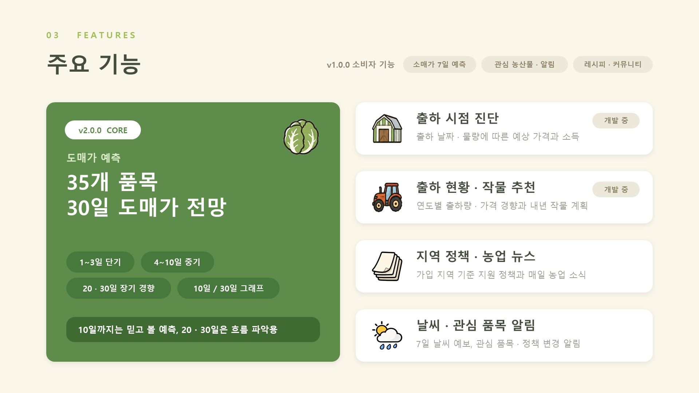
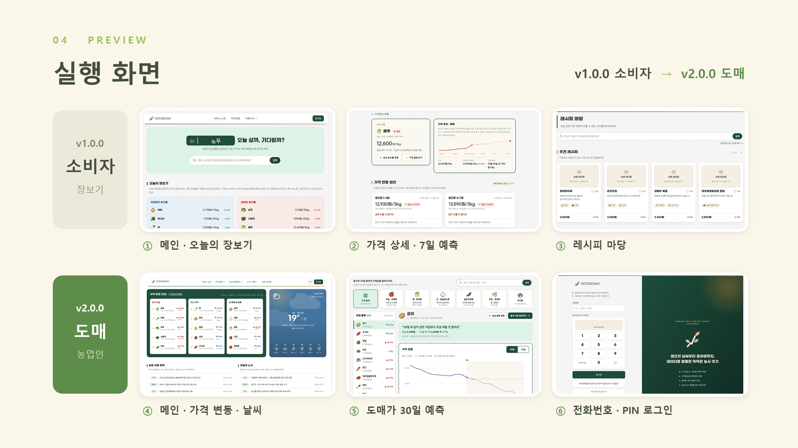
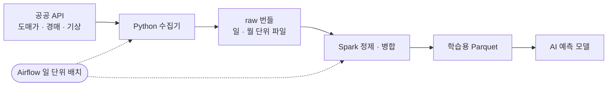

# 🌾 NONGDAM — 데이터 기반 농산물 가격 예측 서비스

> **v1 소비자의 장보기 판단**에서 **v2 농업인의 출하 판단**까지,
> 가격 · 기상 · 출하 데이터로 농산물의 미래 가격을 예측하는 서비스입니다.

| 항목 | 내용 |
|---|---|
| 개발 기간 | 2026.08 ~ 2026.11 |
| 프로젝트 유형 | 팀 프로젝트 / 서비스 고도화 |
| 담당 역할 | Frontend (8\~9월, v1.0.0) → Data (10\~11월, v2.0.0) |
| 예측 대상 | 농산물 35개 품목 |
| 주요 기술 | React 18 · TypeScript · Vite / Python · Airflow · Spark · Hadoop HDFS |

## 01. 프로젝트 소개

## 02. 배경 및 문제점

## 03. 주요 기능

## 04. 실행 화면

## 05. 담당 역할

### Frontend (2026.08 ~ 09) — v1.0.0 소비자 서비스

- React 18 · TypeScript 기반 메인, 가격 정보, 커뮤니티, 마이페이지 화면 구현
- REST API 연동을 통한 소매가 · 7일 예측 데이터 표시
- 가격 추이와 예측 결과를 그래프와 ▲▼, 한 줄 설명으로 시각화
- 관심 농산물 등록 · 가격 알림 등 소비자 편의 기능 UI 구성

### Data (2026.10 ~ 11) — v2.0.0 도매 데이터 파이프라인

- v2 도매가 예측에 필요한 데이터 범위와 수집 기간 정의
- 기상 데이터 담당: 관측 기상(ASOS) · 단기예보 · 중기예보 수집 및 전처리
- AI 학습용 관측 기상 데이터를 만드는 Spark 작업 작성
- 과거 단기예보 · 경매 원천 데이터의 팀 분산 수집 스크립트와 안내문 작성
- Airflow 기반 일 단위 수집 · 전처리 작업 구성

## 06. 기술 스택 및 선정 이유

### Frontend

| 기술 | 선정 이유 |
|---|---|
| React 18 | 가격 카드 · 그래프 등 반복되는 UI를 컴포넌트로 재사용 |
| TypeScript | 가격 · 예측 · 품목 데이터의 타입을 명확히 관리 |
| Vite | 빠른 개발 서버와 효율적인 빌드 |
| Tailwind CSS | 디자인 토큰 기반으로 화면 스타일을 일관되게 유지 |

### Data

| 기술 | 선정 이유 |
|---|---|
| Python | 공공 API 수집기와 전처리 스크립트를 한 언어로 통일 |
| Apache Airflow | 일 단위 수집 · 전처리 작업의 일정과 실행 흐름 관리 |
| Apache Spark | 여러 출처 데이터의 정제 · 병합과 Parquet 생성 |
| Hadoop HDFS | 수집 원본의 분산 저장 및 관리 |

## 07. 기술 구현 정보

### 1) Frontend — 소비자 화면 구현 및 API 연동

React 18과 TypeScript로 소비자가 농산물 가격을 쉽게 확인할 수 있는 화면을 만들었습니다.

- 메인: "오늘 살까, 기다릴까?" 검색과 저렴해진 · 비싸진 농산물 목록
- 가격 정보: 품목별 현재가, 전일 대비 등락, 7일 후 예상 가격
- 가격 상세: 가격 추이 · 예측 그래프, 변동 원인, 관심 등록 · 가격 알림
- API 모듈마다 mock 데이터를 두어 백엔드 연동 전에도 화면 개발과 시연이 가능하도록 구성

숫자가 많은 가격 데이터를 **그래프 + ▲▼ + 한 줄 설명**으로 단순하게 보여 주는 데 중점을 두었습니다.

### 2) Data — 수집 및 처리 파이프라인

- **수집:** aT 도매가 · 경매 원천, 기상청 관측 기상 · 단기 · 중기예보를 출처별 수집기로 확보
- **저장:** raw 원본은 읽기 전용으로 두고, 하루 · 월 단위 파일 하나로 묶어 관리
- **전처리 · 병합:** 결측 · 중복을 검토하고 날짜 · 품목 · 지역 기준으로 출처를 맞춰 Parquet 생성
- **자동화:** Airflow로 매일 수집 · 전처리 작업 실행

### 3) 데이터 확장 및 품질 관리

- 예측 범위를 7일에서 D+1\~10 · 20 · 30으로 늘리고, 과거 데이터 수집 기간을 2021년부터로 확대
- 주요 생산 지역 16곳의 관측 기상과 단기 · 중기예보 활용
- 같은 날짜가 일 · 월 단위 파일에 함께 있으면 작업을 실패시켜 중복 반영 방지
- 작업은 다시 실행해도 결과가 같도록 만들고, 테이블마다 기간별 품질 리포트를 기록

## 08. 트러블슈팅

### 1) HDFS 소형 파일 증가 문제

**문제**
API 응답을 호출 단위로 저장하면 작은 파일이 계속 늘어나 HDFS NameNode의 관리 부담이 커질 수 있었습니다.

**대응 과정**
수집 원본을 하루 · 월 단위 파일 하나로 묶는 방식을 적용하고, 무엇을 묶었는지 manifest에 남겨 원본 추적이 가능하도록 했습니다.

**학습 내용**
HDFS에서는 데이터 용량뿐 아니라 **파일 수와 저장 단위**도 중요하며, 활용 목적에 맞게 배치 구조를 설계해야 한다는 점을 배웠습니다.

### 2) 기상청 API 일일 호출 한도로 과거 예보 수집 중단

**문제**
AI 학습용 과거 단기예보(발표일 1,096일분)를 수집하던 중, 기상청 API허브의 일일 호출 한도로 수집이 멈췄습니다. 100일분에만 원본 약 15,000건, 5GB 이상이 필요했습니다.

**대응 과정**
날짜 범위를 팀원별로 나눠 각자의 인증키로 수집하는 **팀 분산 수집 스크립트와 안내문**을 만들었습니다. 저장된 원본은 해시로 검증하고, 다시 실행하면 완료된 파일은 건너뛰도록 했습니다.

**학습 내용**
외부 API는 호출 구현뿐 아니라 **호출 한도 · 재시작 · 중복 방지**까지 고려해야 하고, 여러 사람이 실행하는 작업일수록 안내문과 검증 절차가 중요하다는 점을 배웠습니다.

### 3) 서비스 대상 전환에 따른 데이터 재정의

**문제**
중간 피드백에서 "소매가는 변동 폭이 작아 소비자의 구매 결정에 영향이 적다"는 지적을 받아, 서비스 대상을 소비자에서 농업인 등 도매 관련자로 바꾸게 되었습니다.

**대응 과정**
예측 대상을 소매가에서 도매가로, 예측 범위를 7일에서 30일로 바꾸는 데 맞춰 수집 대상 · 기간 · 테이블 구성을 다시 정의했습니다.

**학습 내용**
서비스 방향이 바뀌면 화면보다 먼저 **데이터 정의**가 바뀌어야 하며, 데이터 범위를 문서로 합의해 두는 것이 팀 작업의 기준이 된다는 점을 배웠습니다.

## 09. 학습 내용 및 회고

### 학습한 내용

- React 18 · TypeScript 기반 화면 개발과 REST API · mock 데이터 연동
- 농산물 가격 정보와 예측 결과의 그래프 시각화
- Python을 활용한 공공 API 데이터 수집과 Airflow 기반 일 단위 배치 구성
- Spark를 활용한 데이터 정제 · 병합과 HDFS의 저장 구조
- 호출 한도 · 재시작 · 중복 방지를 고려한 대량 수집

### 회고

농담 프로젝트에서는 프론트엔드와 데이터 업무를 모두 맡으며 서비스의 데이터 흐름을 처음부터 끝까지 경험했습니다.

v1.0.0에서는 소비자가 농산물 가격을 쉽게 확인하도록 화면을 만드는 데 집중했고, v2.0.0에서는 도매가 30일 예측에 필요한 데이터를 수집하고 가공하는 역할을 맡았습니다.

특히 서비스 대상이 소비자에서 농업인으로 바뀌는 과정을 겪으며 **누구를 위한 서비스인지에 따라 필요한 데이터와 예측 범위가 달라진다**는 점을 배웠습니다.

화면에서 데이터를 쓰는 입장과 파이프라인에서 데이터를 준비하는 입장을 모두 경험하면서, 두 영역이 어떻게 맞물려야 하는지 이해할 수 있었습니다.

## 10. 출처 및 라이선스

### 참고 자료 및 외부 데이터

- [KAMIS 농산물유통정보](https://www.kamis.or.kr/) — 농산물 가격 데이터
- [공공데이터포털](https://www.data.go.kr/) — aT 도매가격 · 경매 원천정보 API
- [기상청 API허브](https://apihub.kma.go.kr/) — 단기 · 중기예보 데이터
- [기상자료개방포털](https://data.kma.go.kr/) — 관측 기상(ASOS) 데이터

### 라이선스

본 프로젝트는 교육 및 포트폴리오 목적으로 개발되었습니다.

소스 코드의 공개 및 오픈소스 라이선스 적용 여부는 팀의 공개 정책에 따릅니다.
